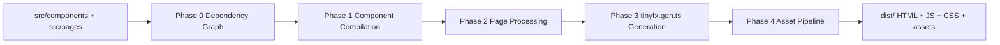

# TinyFX

## What TinyFX Is
TinyFX is a hybrid web framework with a Rust CLI compiler and a TypeScript runtime. It targets developers who want structured TypeScript tooling with server-rendered HTML output, direct DOM control, and low client-side overhead.

The compiler performs component expansion, page processing, directive transformation, glue generation, and bundling orchestration. The runtime provides the browser primitives that remain necessary after compile time.

## How It Works
TinyFX follows a compile-first architecture.



The build phases in `compiler/src/build/mod.rs`:

1. Phase 0: Build dependency graph from `src/components/**/*.html` and `src/pages/**/*.html`.
2. Phase 1: Compile components in dependency order, expand nested components, detect dynamic components, parse component-level `<each>` and `<if>` sites.
3. Phase 2: Compile pages, expand components, process page-level directives, and write resolved HTML to `dist/`.
4. Phase 3: Generate `src/tinyfx.gen.ts` with imports, directive helpers, component wrappers, registry, and router bootstrap.
5. Phase 4: Bundle `src/main.ts` and generated glue with esbuild, then copy styles and assets.

Runtime exports in `runtime/src/index.ts`:
- `signal`, `effect`
- `registerInstance`, `destroyNode`
- `bindText`, `bindAttr`, `bindClass`
- `createHttp`
- `getParam`, `getParams`, `navigate`, `goBack`
- `onMount`, `onDestroy`
- `TinyFxContext`
- `RouteMap`, `RouteMeta`
- `registerComponent`, `getComponentFactory`, `mountComponents`
- `registerPage`, `getPageModule`, `runPageInit`
- `markMounted`, `isMounted`
- `matchPath`, `splitPath`, `RouteDef`
- `init`

## Getting Started
```bash
cargo install --path compiler
tinyfx init my-app
cd my-app
tinyfx serve
```

## Scaffolded Project Structure
Current scaffold output from `tinyfx init`:

```text
my-app/
├── AGENTS.md
├── package.json
├── tinyfx.toml
├── tsconfig.json
└── src/
    ├── main.ts
    ├── pages/
    │   ├── index.html
    │   └── index.ts
    ├── components/
    │   ├── FeatureCard/
    │   │   └── FeatureCard.html
    │   └── ThemeToggle/
    │       ├── ThemeToggle.html
    │       └── ThemeToggle.ts
    ├── lib/
    │   ├── dto/
    │   ├── models/
    │   ├── services/
    │   └── state/
    │       ├── app.state.ts
    │       └── theme.state.ts
    └── styles/
        └── main.css
```

## Core Concepts

### Pages
Pages live in `src/pages/` and must use a `<page>` root.

```html
<!-- src/pages/about.html -->
<page route="/about" layout="">
  <main class="about-page">
    <h1>About</h1>
  </main>
</page>
```

```ts
// src/pages/about.ts
import { onMount } from "@tinyfx/runtime";
import type { TinyFxContext } from "@tinyfx/runtime";

export function init(_el: HTMLElement, _ctx: TinyFxContext): void {
  onMount(() => {
    console.log("about mounted");
  });
}
```

### Static Components
Static is the default behavior. The compiler expands static components at build time into plain HTML. Static components are HTML-only — no `.ts` file is needed.

```html
<!-- src/components/FeatureCard/FeatureCard.html -->
<div class="feature-card">
  <div class="feature-icon">
    <i class="{{icon}}"></i>
  </div>
  <h3 class="feature-title">{{title}}</h3>
  <p class="feature-description">{{description}}</p>
</div>
```

### Dynamic Components
Dynamic components opt in with `tinyfx-dynamic` on the root element and a sibling same-name `.ts` file.

```html
<!-- src/components/ThemeToggle/ThemeToggle.html -->
<button class="theme-toggle" tinyfx-dynamic aria-label="Toggle theme">
  <i class="fa-solid fa-moon"></i>
</button>
```

```ts
// src/components/ThemeToggle/ThemeToggle.ts
import { effect } from "@tinyfx/runtime";
import type { TinyFxContext } from "@tinyfx/runtime";
import { theme } from "@state/theme.state";

export class ThemeToggle {
  private icon: HTMLElement | null = null;

  constructor(public el: HTMLElement, public ctx: TinyFxContext) {}

  init(): void {
    this.icon = this.el.querySelector("i");

    effect(() => {
      const isDark = theme() === "dark";
      if (this.icon) {
        this.icon.className = isDark ? "fa-solid fa-sun" : "fa-solid fa-moon";
      }
    });

    this.el.addEventListener("click", () => {
      theme.set(theme() === "dark" ? "light" : "dark");
    });
  }

  destroy?(): void {
    // cleanup
  }
}

export function mount(el: HTMLElement, ctx: TinyFxContext) {
  const inst = new ThemeToggle(el, ctx);
  inst.init();
  return inst;
}
```

Compiler enforcement:
- `tinyfx-dynamic` present and no sibling `.ts`: build error.
- sibling `.ts` present and no `tinyfx-dynamic`: build warning.

### Signals and Reactivity
Signals are explicit callable state holders. `effect()` subscribes to signal reads.

```ts
// src/lib/state/chat.state.ts
import { signal } from "@tinyfx/runtime";

export const messages = signal<{ id: number; content: string }[]>([]);
```

### `<each>` Directive

```html
<!-- src/components/Chat/Chat.html -->
<section class="chat" data-component="Chat" tinyfx-dynamic>
  <each of="messages()" as="message" key="id">
    <PostCard title="{{message.title}}" />
  </each>
</section>
```

Supported `of` forms:
- signal call: `posts()`
- plain array expression: `posts`
- integer count: `10`
- range: `1..5`

Compiler behavior:
- Replaces the directive site with a container: `<div data-each="SITE_ID" ...></div>`.
- Preserves non-control attributes from `<each>` on the generated wrapper.
- Generates `__create_*`, `__update_*`, and `__reconcile_*` functions.
- Wires reconciliation via `effect()` for signal sources. Plain and range sources do not use `effect()`.

Generated updates use targeted DOM operations rather than subtree replacement:

```ts
// src/tinyfx.gen.ts (generated)
el.querySelector<HTMLElement>("h3.feature-title")?.textContent = String(post.title);
```

Layout note:

```css
/* src/styles/main.css */
[data-each="chat_each_0"] {
  display: contents;
}
```

`display: contents` can preserve flex/grid behavior when the generated wrapper affects layout.

### `<if>` Directive

```html
<!-- src/components/AuthGate/AuthGate.html -->
<section class="auth" data-component="AuthGate" tinyfx-dynamic>
  <if condition="isLoggedIn()">
    <Dashboard />
  <else>
    <Login />
  </if>
</section>
```

Supports chains:

```html
<if condition="isAdmin()">
  <AdminPanel />
<else-if condition="isLoggedIn()">
  <Dashboard />
<else>
  <Login />
</if>
```

Compiler behavior:
- Pre-renders all branches into HTML.
- Wraps each branch with `data-branch` and initial `hidden` state.
- Generates a `__toggle_*` function to show the active branch.
- Signal-based conditions use `effect()` for reactivity; plain conditions do not.

### Bootstrap
The generated `tinyfx.gen.ts` calls `init()` automatically on page load. You do not need to call it yourself.

```ts
// src/tinyfx.gen.ts (generated)
init({ routes, setupDirectives });
```

The `init()` function:
1. Matches the current URL path against registered routes.
2. Initializes lifecycle hooks (`onMount`, `onDestroy`).
3. Sets route params.
4. Mounts all dynamic components in the page.
5. Runs page-level `init()` if present.

### Component Wrapper System
For each dynamic component, TinyFX generates a wrapper in `tinyfx.gen.ts`.

```ts
// src/tinyfx.gen.ts (generated)
function __mount_Chat(el: HTMLElement, ctx: TinyFxContext): any {
  const inst = mountComponent(ChatModule, el, ctx);
  if (!inst) return null;

  const __each_chat_each_0 = el.querySelector<HTMLElement>("[data-each='chat_each_0']");
  if (__each_chat_each_0) {
    effect(() => __reconcile_chat_each_0(__each_chat_each_0, inst.messages(), ctx));
  }

  return inst;
}
```

Key mechanics:
- Wrapper uses `el.querySelector`, not `document.querySelector`, so multiple component instances wire independently.
- Wrapper reads signals through `inst.signalName()`.
- Wrapper code is generated by the compiler and overwritten on each build.

Public field requirement:
- Signals referenced by component template directives, such as `<each of="messages()">`, must be `public` on the component class because generated code accesses `inst.messages()`.

### Component Communication
Three implemented patterns:

1. Shared signals in `src/lib/state/`.
2. HTML attributes for parent-to-child render data.
3. Custom DOM events for child-to-parent notifications.

```ts
// src/components/Composer/Composer.ts
this.el.dispatchEvent(
  new CustomEvent("message:sent", {
    detail: { content: "hello" },
    bubbles: true,
  }),
);
```

```ts
// src/components/Chat/Chat.ts
this.el.addEventListener("message:sent", (event: Event) => {
  const custom = event as CustomEvent<{ content: string }>;
  console.log(custom.detail.content);
});
```

### The lib Folder and Path Aliases
```text
src/lib/
├── models/     # frontend model classes
├── dto/        # API DTO types
├── state/      # shared signals
└── services/   # service factories
```

Use direct file imports via aliases, not barrels:

```ts
// src/components/Profile/Profile.ts
import { User } from "@models/user.model";
import type { UserDto } from "@dto/user.dto";
import { currentUser } from "@state/app.state";
import { createUserService } from "@services/user.service";
```

### Services
Services use factory functions, not classes.

```ts
// src/lib/services/user.service.ts
import { createHttp } from "@tinyfx/runtime";
import type { UserDto } from "@dto/user.dto";
import { User } from "@models/user.model";

const http = createHttp({ baseUrl: "/api" });

export function createUserService() {
  return {
    async getUser(id: number): Promise<User> {
      const dto = await http.get<UserDto>(`/users/${id}`);
      return User.from(dto);
    },
  };
}

export type UserService = ReturnType<typeof createUserService>;
```

No DI container is used by runtime or compiler for services.

## Real Working Example: Chat

```html
<!-- src/components/Chat/Chat.html -->
<section class="chat" data-component="Chat" tinyfx-dynamic>
  <div class="container">
    <header>
      <h1>Global Chat!</h1>
    </header>

    <div id="chat-container">
      <each of="messages()" as="message" key="id">
        <ChatMessage
          username="{{message.username}}"
          content="{{message.content}}"
          own="{{message.own}}"
        />
      </each>
    </div>

    <div id="message-form">
      <input type="text" id="username" placeholder="Name">
      <div class="input-wrapper">
        <input type="text" id="content" placeholder="Type a message...">
        <button id="send-btn">Send</button>
      </div>
    </div>
  </div>
</section>
```

```ts
// src/components/Chat/Chat.ts
import { signal } from "@tinyfx/runtime";
import type { TinyFxContext } from "@tinyfx/runtime";
import { createMessageService } from "@services/message.service";

type MessageDto = {
  id: number;
  username: string;
  content: string;
  own?: "sent" | "received";
};

export class Chat {
  public messages = signal<MessageDto[]>([]);
  private currentUsername = signal("currentUser");
  private messageService = createMessageService();
  private pollInterval?: ReturnType<typeof setInterval>;

  constructor(public el: HTMLElement, public ctx: TinyFxContext) {}

  private async fetchMessages(): Promise<void> {
    const msgs = await this.messageService.getMessages();
    const withOwn = msgs.map((msg: MessageDto) => ({
      ...msg,
      own: msg.username === this.currentUsername() ? "sent" : "received",
    }));
    this.messages.set(withOwn);
  }

  init(): void {
    this.el
      .querySelector<HTMLButtonElement>("#send-btn")
      ?.addEventListener("click", () => {
        void this.sendMessage();
      });

    void this.fetchMessages();
    this.pollInterval = setInterval(() => {
      void this.fetchMessages();
    }, 5000);
  }

  destroy?(): void {
    if (this.pollInterval) {
      clearInterval(this.pollInterval);
    }
  }

  private async sendMessage(): Promise<void> {
    const contentInput = this.el.querySelector<HTMLInputElement>("#content");
    const content = contentInput?.value.trim() ?? "";
    if (!content) return;

    await this.messageService.sendMessage({
      username: this.currentUsername(),
      content,
    });

    if (contentInput) contentInput.value = "";
    await this.fetchMessages();
  }
}

export function mount(el: HTMLElement, ctx: TinyFxContext) {
  const inst = new Chat(el, ctx);
  inst.init();
  return inst;
}
```

```html
<!-- src/components/ChatMessage/ChatMessage.html -->
<div class="message {{own}}">
  <span class="user">{{username}}</span>
  <p>{{content}}</p>
</div>
```

```css
/* src/styles/main.css */
[data-each="chat_each_0"] {
  display: contents;
}
```

## CLI Reference

### `tinyfx init`
```bash
tinyfx init <name>
```
Creates a new TinyFX project directory from compiler templates.

### `tinyfx build`
```bash
tinyfx build [--config tinyfx.toml] [--phase-one-only] [--assets-dir <path>]
```
Runs build phases and writes output to `out_dir`.

### `tinyfx serve`
```bash
tinyfx serve [--config tinyfx.toml]
```
Runs initial build, starts HTTP server, WebSocket reload server, and file watcher.

### `tinyfx generate` (`tinyfx g`)
```bash
tinyfx generate component <Name> [--dynamic]
tinyfx generate page <name>
tinyfx generate service <Name>
tinyfx generate model <Name>
tinyfx generate dto <Name>
tinyfx generate interface <Name>
```

Aliases in CLI:
- `component` alias: `c`
- `service` alias: `s`
- `model` alias: `m`
- `dto` alias: `d`
- `interface` alias: `i`
- `page` alias: `p`

## Configuration
Active `tinyfx.toml` fields from `compiler/src/config.rs`:

| Field | Type | Default | Used by compiler |
|---|---|---|---|
| `entry` | `string` | `"src"` | Present in config model, not used in build phases |
| `entry_ts` | `string` | `"src/main.ts"` | Yes |
| `out_dir` | `string` | `"dist"` | Yes |
| `components` | `string` | `"src/components"` | Yes |
| `styles` | `string` | `"src/styles"` | Yes |
| `static_dirs` | `string[]` | `[]` | Yes |
| `assets_dir` | `string` | `"src/assets"` | Yes |
| `pages` | `string` | `"src/pages"` | Yes |
| `phase_one_only` | `bool` | `false` | Yes |

Example:

```toml
entry = "src"
entry_ts = "src/main.ts"
out_dir = "dist"
components = "src/components"
styles = "src/styles"
static_dirs = ["public"]
assets_dir = "src/assets"
pages = "src/pages"
phase_one_only = false
```

Note: scaffolded `[server]` and `[router]` sections are template placeholders and are not read by current compiler config parsing.

## Design Principles

### HTML Is the Source of Truth
Pages and component templates are authored in HTML files. Build output remains inspectable as HTML files under `dist/`.

### Compile Time Over Runtime
Component expansion, directive site transformation, and route glue generation occur before browser execution.

### Explicit Over Magic
Dynamic behavior requires explicit `tinyfx-dynamic` and explicit module exports. Services are explicit factory functions.

### JavaScript Enhances, It Does Not Replace
Runtime code mounts behavior on DOM that already exists from compile output.

### Small Enough to Understand
Compiler and runtime responsibilities are split with clear boundaries and deterministic generation.

### Islands by Default
Static components carry no runtime mount behavior. Dynamic behavior is opt-in per component.

## Status

| Feature | Status |
|---|---|
| Static component expansion | ✅ Implemented |
| Dynamic components | ✅ Implemented |
| File-based hard router | ✅ Implemented |
| Signals and effects | ✅ Implemented |
| `<each>` directive | ✅ Implemented |
| `<if>` / `<else>` directive | ✅ Implemented |
| Component wrapper system | ✅ Implemented |
| Dev server with live reload | ✅ Implemented |
| Dynamic component/page registries | ✅ Implemented |
| Conditional reactivity imports | ✅ Implemented |
| Soft router | 📋 Planned |
| Class-to-closure transformation | 📋 Planned |
| Lazy component loading | 📋 Planned |
